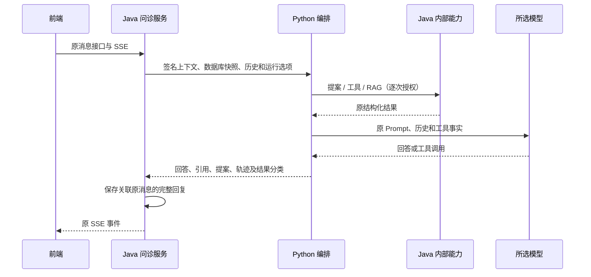

# Java 问诊接入 Python（第 5 项）

迁移版的 `ConsultationService` 通过 `AgentGateway` 调用 `PythonAgentGateway`，生产调用只走 Python HTTP 编排。第 6 项已删除旧 Java 编排与问诊客户端，没有自动回退或旧编排切换开关。运行和部署见 [交付说明](python-agent-delivery.md)。

## 调用和持久化



急症和提案提前返回沿用原 Python 分支，不必调用模型。Java 仍从当前用户授权范围生成快照和历史，并创建、签发上下文。前端不能指定 Python 地址、患者签名或回调凭据。

保存完成后，Java 按原顺序发送 `agent_tool`、`thinking_done`、`action_proposal`、`citation`、`token`、`done`；新生成前还有 `thinking`。`token` 仍是完整回答。已完成回复从数据库重放，不重新运行 Python。客户端消息去重、进行中消息拦截、健康概况刷新和提案确认逻辑继续留在 Java。

## 本地配置

启动前在 Java 进程配置以下变量；真实值放在本地环境，不提交仓库：

```text
APP_AGENT_INTERNAL_ENABLED=true
APP_AGENT_SERVICE_TOKEN=<独立服务间凭据>
APP_AGENT_CONTEXT_SECRET=<不同于服务凭据、仅留在 Java 的签名密钥>
APP_AGENT_PYTHON_BASE_URL=http://127.0.0.1:8093
APP_AGENT_INTERNAL_CONNECT_TIMEOUT_MS=3000
APP_AGENT_INTERNAL_MAX_REQUEST_MS=170000
```

Python 进程配置相同的 `APP_AGENT_SERVICE_TOKEN`，以及 `APP_AGENT_JAVA_BASE_URL=http://127.0.0.1:8080` 和所选 `APP_AI_*`。Python 不接收 Java 签名密钥。两端均不自动读取对方的 `.env`。Python 初始化和启动方式见 [运行说明](../kangban-agent/README.md)，Java 回调授权见 [内部接口说明](python-agent-internal-api.md)。

Java 的 Python 地址必须是无用户信息、查询、片段和额外路径的 HTTP(S) 服务根地址。内部接口默认关闭，未配置时问诊安全失败；不会调用旧 Java 模型。迁移版运行需要 Java 与 Python 同时启动，统一启动脚本、部署模板和 CI 已补齐。

## 失败、取消和检查

- 使用仓库已有 OkHttp 依赖，关闭连接失败重试、重定向和环境代理，不新增 Maven 依赖。
- 同一截止时间不超过上下文到期、配置预算和 170 秒总上限；整体 HTTP 超时包含连接、发送和响应读取，为原 180 秒 SSE 留出余量。
- SSE 超时、出错或结束会取消尚在进行的 HTTP 调用。取消先于调用启动也有效；工作退出后释放进行中标记。已保存回复仍可按原消息重放。浏览器无网络活动时断连通知可能延迟，总预算仍提供上限。
- 在旧 Java record 归一化前检查返回值：版本、`runId`、结果分类、字段集合、必需数组、字段类型、引用、提案状态、轨迹状态/迭代/耗时。拒绝重复 JSON 字段、尾随 JSON、空回答和无效结构。
- 错误只选择本地安全文案并通过原 `ai_error` 事件返回。远端错误正文、密钥、签名和病历不写入错误日志或 SSE。
- 普通运行与急症各记一次原运行指标；提案提前返回不记普通成功。工具指标由 Java 回调执行处记录，网关不重复计数。新增服务连接和协议失败记为运行失败。
- `kangbanAgent` 健康项改为检查内部配置及 Python `/health`，每次探测最多 2 秒；Agent 关闭为 `OUT_OF_SERVICE`，未配置或 Python 不可达为 `DOWN`。公开 `/actuator/health` 仍不需登录、也不展示凭据；缺少 Python 配置时返回 503。该存活探测不证明模型和全部业务依赖就绪。

`PythonAgentGatewayTest` 使用本机模拟 HTTP 检查协议、签名、超时、取消、失败文案、无重试/重定向、指标和健康。`PythonConsultationIntegrationTest` 启动真实 Java HTTP 服务、独立 Python/Uvicorn 进程、H2 和本机模型接口，执行真实公开 REST/SSE 与受认证回调。清理后检查唯一运行网关，`PythonMigrationBoundaryTest` 另外验证 11 个旧类从运行类路径缺席。

完整联调测试需要先初始化 `kangban-agent/.venv`，也可用 `-Dkangban.python.executable=<绝对解释器路径>` 指定已安装项目依赖的 Python。测试只使用合成账号、病历和凭据，强制模型地址指向本机，未授权的真实服务不参与。辅助进程及其子进程在测试后关闭，并检查端口释放。

本阶段的具体测试计数和最终结果见 [进度记录](python-agent-migration-progress.md)。固定输入与模拟 HTTP 验收不能代替真实模型、数据库、MCP 的网络、输出及性能验证；真实联调仍需用户另行授权。
